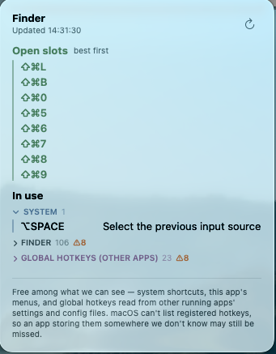

# KeyOpen

**A macOS menu-bar app that tells you which keyboard shortcuts are still free.**

Press `⌃⌥⌘K` in any app and KeyOpen shows what's already taken there — system
shortcuts, that app's menu commands, and the global hotkeys other running apps
have registered — then ranks the ergonomic combos you could still claim.


> **Suggest-only.** KeyOpen never changes a binding or a system setting. It reads
> and reports; you decide.

<p align="center">
  
</p>

Eight free combos up top, then what's taken. `⚠︎10` on a folded section means ten
of its rows collide with something else.

## Why

Shortcut *discovery* and *conflict detection* are solved — HotkeyClash (free,
GPL-2.0) does it well. **Recommendation isn't.** No tool answers the question you
actually have when you're in an app's settings pane with a text field waiting:
*which combo can I safely give this?*

That's the whole app. Everything else — the in-use list, the conflict flags —
falls out of the data model needed to answer it.

## Install

No notarized release yet; build it yourself (~10 seconds):

```sh
git clone https://github.com/hjl1045/macos-shortcut-helper.git
cd macos-shortcut-helper
./scripts/package.sh
mv KeyOpen.app /Applications/ && open /Applications/KeyOpen.app
```

A keyboard icon appears in the menu bar — no Dock icon, no terminal to keep open.

**Requirements:** macOS 13+, Xcode or the Swift 5.9+ toolchain to build.

## Usage

Two ways in, both reading the app you were *just* using:

- **Click** the menu-bar icon.
- **Press `⌃⌥⌘K`** from anywhere — a floating panel appears; press again to dismiss.
  Handy when you're mid-setup in another app's preferences.

The **↻** button rescans on demand. Because rescanning an unchanged app produces
identical rows, the header shows `Updated HH:MM:SS` and a spinner while it runs,
so you can tell it actually ran.

**Open slots come first** — it's the answer the app exists to give, ranked best
first. A combo whose simpler form on the same key is already bound (`⇧⌘D` when
`⌘D` is taken) is still offered, but ranked below fully-clean keys and marked
`already bound — stacks a modifier on a busy key`.

**Color says what you can do with a key**, so a glance is usually enough:

| Colour | Light | Dark | Meaning |
|---|---|---|---|
| sage | `#4C8666` | `#8CBFA3` | free — take it |
| slate | `#517A9C` | `#93B4CE` | macOS owns it; effectively off-limits |
| plum | `#7B6994` | `#B2A2C7` | another app's global hotkey — negotiable, rebind *that* app |
| grey | — | — | this app's menu commands; only matter while you're in it |
| amber | `#A96D3E` | `#D8A87A` | a conflict or a caveat |

These are muted on purpose — the stock `.green` / `.blue` / `.purple` are system
accent colours at full chroma, which shout over the text they're classifying.
Each has a value per appearance rather than one compromise between light and dark.

**Sections fold.** Anything over 12 rows starts collapsed — an app's fifty-command
menu is a wall — and collapsed headers keep reporting their row and conflict
counts (`▶ LINEAR 48 ⚠︎2`), so folding a section never hides that something in it
needs attention. The list scrolls within a fixed ceiling; the header and the
caveat below it stay put.

**Conflicts explain themselves.** Two bindings on one combo are rarely equal
partners: a global hotkey is dispatched before the frontmost app sees the key, so
the app's menu command never fires at all. The row says which one loses:

```
⇧⌘K   Network                                                        ⚠︎
      Blocked by LocalFlow · Toggle Dictation — a global hotkey fires first
```

Every such note is inline rather than a tooltip — hover hints don't surface in a
menu-bar window, so anything hidden behind one is never read.

## What KeyOpen can and can't see

This is the honest part, and it's load-bearing: **macOS has no API to enumerate
the global hotkeys apps have registered.** "Free" therefore always means *free
among what we can see*.

| Source | How |
|---|---|
| System shortcuts | `com.apple.symbolichotkeys` preferences |
| The current app's menu commands | Accessibility, walking its menu bar |
| Global hotkeys of Swift apps | the [`KeyboardShortcuts`](https://github.com/sindresorhus/KeyboardShortcuts) library's stored prefs |
| Global hotkeys of known config-file apps | reading that app's own config |

Apps using the `KeyboardShortcuts` library need no reader of their own — that row
covers all of them at once (superwhisper, for one).

That last row needs a reader **per app**, because there is no shared format.
Three apps, three encodings, none alike:

| App | Where | Encoding |
|---|---|---|
| **Wispr Flow** | `~/Library/Application Support/Wispr Flow/config.json` | `+`-joined virtual key codes, modifiers as codes of their own: `"32+55+56": "popo"` = ⇧⌘U |
| **Keyboard Maestro** | `~/Library/Application Support/Keyboard Maestro/Keyboard Maestro Macros.plist` | per-macro `HotKey` triggers, Carbon key code + **Carbon** modifier mask: `{KeyCode: 18, Modifiers: 6400}` = ⌃⌥⌘1 |
| **Alfred** | `…/Alfred.alfredpreferences/preferences/local/<hash>/…/prefs.plist` | `{key: 49, mod: 1048576, string: " "}` — Carbon key code but a **Cocoa** `NSEvent` mask |

Only *running* apps are read, since a global hotkey is live only while its owner
is — and it's the process that registers them that must be running, which for
Keyboard Maestro is its background **engine**, not the editor. Disabled macros and
macro groups are skipped; ones scoped to a single app are not, because a slot
that's taken whenever that app is frontmost isn't free.

A global hotkey belonging to the app you're currently in is listed **in that app's
own section**, not under "other apps" — from where you're sitting, Wispr Flow's
⇧⌘U is Wispr Flow's.

### Deliberately not read

**Discord** (keybinds live server-side with the account; the local `settings.json`
holds only window state), **Slack** (nothing written until first launch), and
**Telegram** (prefs contain no shortcut keys; the rest is an encrypted store).
Nothing on disk says what their hotkeys are, and guessing would be worse than
missing them.

Apps using raw `RegisterEventHotKey`, `MASShortcut`, sandboxed prefs, or a config
we don't have a reader for can still be missed.

## Adding support for another app

This is the most useful contribution, and the bar is deliberately high.

A hotkey KeyOpen can't see doesn't merely go unlisted — **it gets recommended as
a free slot**, which is the one answer this app must not get wrong. So a decoder
ships only once its format is confirmed against ground truth, never inferred from
a plausible-looking file.

1. Find where the app persists hotkeys (`~/Library/Preferences/<bundleid>.plist`,
   `~/Library/Application Support/<App>/`).
2. **Confirm the encoding against something independently known** — a hotkey you
   set yourself, or the app's own rendering of it. Keyboard Maestro's mask was
   verified by diffing against its engine's `getmacros with asstring` output;
   Alfred's by decoding its ⌘Space with Spotlight's ⌘Space disabled.
3. Add a decoder in [`AppConfigHotkeyCollector.swift`](Sources/KeyOpenCore/AppConfigHotkeyCollector.swift),
   conforming to `SingleFileHotkeyConfig` where the app keeps one file.
4. Add unit tests over a fixture **plus** an integration test that reads the real
   installed file and `XCTSkip`s when the app is absent — so the fixture can't
   quietly drift into a format nobody actually uses.

If a format can't be confirmed, say so in the "deliberately not read" list instead.

## Permissions

Grant Accessibility on first run: **System Settings → Privacy & Security →
Accessibility** (the *privacy* pane listing apps allowed to control your Mac —
**not** the separate Accessibility *features* pane), then enable **KeyOpen**.
Without it you still get system shortcuts and other apps' global hotkeys; reading
the current app's menus is what needs it.

**Keeping the grant across rebuilds.** `package.sh` signs with a *stable* identity
when one is available — an Xcode **Apple Development** certificate is picked up
automatically, or set `CODESIGN_IDENTITY="…"`. With no cert it falls back to
ad-hoc signing, whose code hash changes every build, so macOS silently resets the
grant on each rebuild (Settings shows it enabled while the app reports "not
granted" — a stale entry). `./scripts/setup-signing.sh` creates a local identity
for that case. To clear a stale entry:

```sh
tccutil reset Accessibility com.hjl1045.KeyOpen
```

## Development

```sh
swift build -c release
.build/release/KeyOpen     # foreground; closing the terminal quits it
swift test                 # 61 tests
```

The scan logic lives in `KeyOpenCore` as pure functions over `Data`, so every
decoder is testable without the GUI. `KeyOpen` is the thin AppKit/SwiftUI shell.

- **Distribution** — [docs/DISTRIBUTION.md](docs/DISTRIBUTION.md): porting to
  another Mac, handing off the built app, publishing a Homebrew cask
  (`scripts/release.sh` builds the zip).
- **Design** — [the design spec](docs/superpowers/specs/2026-07-05-macos-shortcut-helper-design.md)
  covers the prior art survey and why recommendation is the gap worth building.
- The app icon is generated by `scripts/make-icon.swift` and embedded at package time.

## License

[MIT](LICENSE) © Jieling Han
